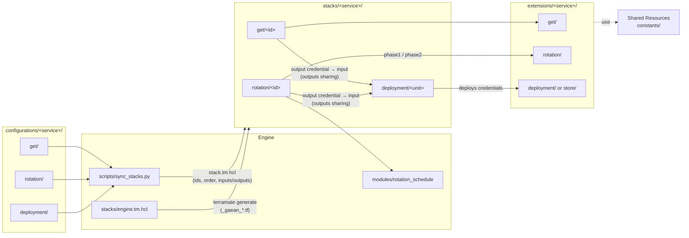

# Architecture Overview

The system follows a modular architecture with these core components:

1. **Stack sync** (`scripts/sync_stacks.py`): turns the configurations into Terramate stacks, one per
   credential and per deployment unit, and wires them together by the credentials they reference
2. **Core Engine** (`stacks/engine.tm.hcl` + `modules/`): the OpenTofu code Terramate generates into every
   stack (configuration loading, the dual-phase rotation schedule, the extension call)
3. **Extensions**: Service-specific implementations for various platforms
4. **Shared Resources**: Common constants and utilities



Stacks are created ahead of time: `sync_stacks.py` turns the configurations into stack files, and
`terramate generate` writes the engine code into each stack. At run time the stacks form a graph. Get and
rotation stacks produce credentials (`output` blocks); the stacks that reference them consume those
credentials (`input` blocks, Terramate outputs sharing) and run after them. A rotation stack runs its
extension as two phases, driven by `modules/rotation_schedule`. The shared constants are available to
every extension. See [Stacks](./stacks.md) for the details.

# Project Structure

```
Gaean Key/
├── terramate.tm.hcl                       # Terramate project config (outputs sharing backend)
├── README.md                              # This documentation
├── constants/                             # Shared OpenTofu outputs and constants
├── docs/adr/                              # Architecture decision records
├── scripts/sync_stacks.py                 # Writes the stacks from configurations/
├── stacks/                                # Terramate stacks (written + generated, don't edit)
│   ├── engine.tm.hcl                      # Code generation templates: the engine
│   └── <service>/<stage>/<id>/            # One stack per credential / deployment unit
├── modules                                # Core OpenTofu modules used by the generated code
│   ├── config_processor.jinja2            # Jinja2 template rebuilding the folder hierarchy of deployment configs
│   └── rotation_schedule/                 # Dual-phase rotation timers of one credential (phases/ is the pure math)
├── configurations/                        # service-specific configurations
│   └── <service>/                         # service-specific configuration folders
│       ├── service.yml                    # (Optional) defaults merged under every config of the service
│       ├── deployment/                    # Deployment configurations
│       ├── rotation/                      # Rotation configurations
│       └── get/                           # Retrieval configurations
├── examples/configurations/               # Example configurations of the bundled extensions
├── extensions/                            # Service-specific implementations
│   └── <service>/                         # Service-specific extension folders
│       ├── deployment/ or store/          # Deployment / Store component
│       ├── rotation/                      # Rotation component
│       ├── get/                           # Get component
│       └── <component>/gaean.tm.hcl       # (Optional) provider configuration of the stacks using the component
│       └── <component>/tests/             # tofu test suites of the component (mock providers)
└── tests/                                 # Unit tests of the sync script
```
