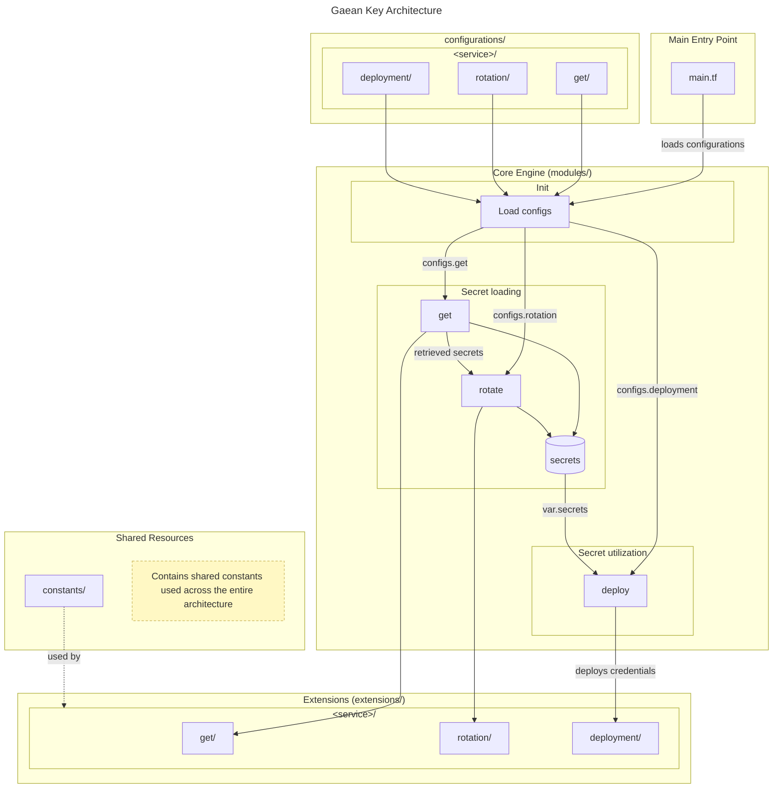

# Architecture Overview

The system follows a modular architecture with these core components:

1. **Main Entry Point**: Central configuration and orchestration
2. **Core Engine**: Handles the parsing and loading of configurations and data  to extensions
3. **Extensions**: Service-specific implementations for various platforms
4. **Shared Resources**: Common constants and utilities

```
┌─────────────┐                  
│  Main Entry │                  
│    Point    │                  
└─────┬───────┘                  
      │ Calls                         
      ▼                          
┌─────────────────────────────┐  
│         Core Engine         │  
├─────────┬─────────┬─────────┤  
│  Init   │ Secret  │ Secret  │  
│         │ Loading │ Usage   │  
└─────────┴────┬────┴────┬────┘  
               │         │       
       ┌───────┴─────────┘
       ▼     Implemented by
┌─────────────┐         ┌─────────────┐ 
│ Extensions  │ Used by │ Shared      │
│             │<--------│ Resources   │
└─────────────┘         └─────────────┘
```

## Architecture Diagram

How configurations flow through the engine into the extensions:



# Project Structure

```
Gaean Key/
├── main.tf                                # Main entry point for OpenTofu
├── versions.tf                            # Required providers and provider configuration
├── README.md                              # This documentation
├── constants/                             # Shared OpenTofu outputs and constants
├── docs/adr/                              # Architecture decision records
├── modules                                # Core OpenTofu engine
│   ├── config_processor.jinja2            # Jinja2 template rebuilding the folder hierarchy of configs
│   ├── load_configs/                      # Configuration loading (incl. service.yml defaults)
│   ├── get/                               # Secret retrieval functionality
│   ├── rotate/                            # Secret rotation functionality (dual-phase; modules.tf wires the extensions, providers.tf their gated providers)
│   └── deploy/                            # Secret deployment functionality (providers.tf: gated providers)
├── examples/configurations/               # Example configurations of the bundled extensions
├── tests/                                 # tofu test suites (engine end-to-end, extensions with mock providers)
├── configurations/                        # service-specific configurations
│   └── <service>/                         # service-specific configuration folders
│       ├── service.yml                    # (Optional) defaults merged under every config of the service
│       ├── deployment/                    # Deployment configurations
│       ├── rotation/                      # Rotation configurations
│       └── get/                           # Retrieval configurations
└── extensions/                            # Service-specific implementations
    └── <service>/                         # Service-specific extension folders
        ├── deployment/                   # Deployment component
        ├── rotation/                     # Rotation component
        └── get/                           # Get component
```
