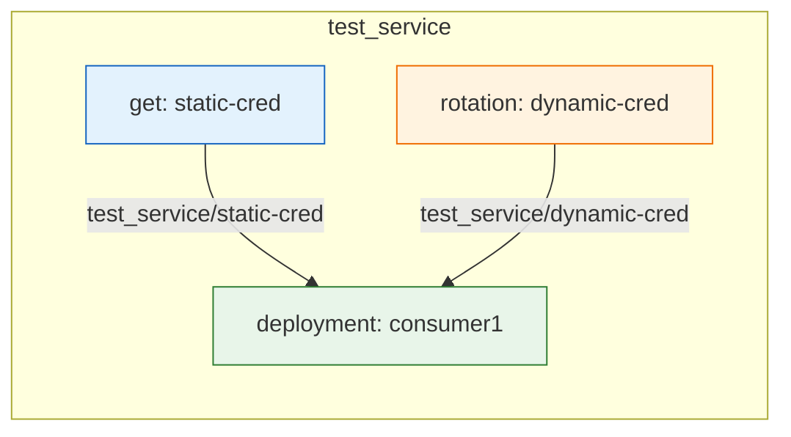

# Stacks

The engine runs on [Terramate](https://terramate.io/) stacks instead of one OpenTofu root module. Each
credential and each deployment unit is its own stack with its own state, and the stacks are wired together
by what the configurations reference.

## Why stacks

- **Blast radius**: rotating a credential plans and applies only its stack and the stacks that consume it,
  never the whole estate. A broken or unreachable service fails only its own stacks.
- **Selective secrets passing**: a consumer only receives the credentials its configurations reference
  (option 3 of [the ADR](./adr/20260303-fix-circular-dependency-in-rotation-lifecycle.md)), instead of the
  full secret map. The graph-wide coupling behind that ADR's cycle no longer exists.
- **Change detection and ordering**: `terramate run --changed --include-all-dependents` applies only what a
  change affects, in dependency order, optionally in parallel (`-j`).
- **No manual wiring**: a new extension or configuration needs no engine change; the stacks and their
  OpenTofu code are generated.

## Layout

```
configurations/<service>/get/<id>.yml              -> stacks/<service>/get/<id>/
configurations/<service>/rotation/<id>.yml         -> stacks/<service>/rotation/<id>/
configurations/<service>/deployment/<unit>/**.yml  -> stacks/<service>/deployment/<unit>/
```

- `<id>` is the path of the file below `get/` or `rotation/` without `.yml`, which is also the secret id
  consumers reference (`secret: {service: <service>, id: <id>}`).
- A deployment unit is the first folder (or file) below `deployment/`; all its files are deployed by one
  stack, nested by folder structure exactly as before.

Every stack directory contains:

| File                   | Written by                    | Content                                                                 |
|------------------------|-------------------------------|-------------------------------------------------------------------------|
| `stack.tm.hcl`         | `scripts/sync_stacks.py`      | stack id/tags/order/watch list, `globals "gaean"`, `output`/`input` blocks |
| `_gaean_terraform.tf`  | `terramate generate`          | required versions and providers                                         |
| `_gaean_config.tf`     | `terramate generate`          | config loading (`service.yml` merge), placeholders, referenced secrets  |
| `_gaean_<stage>.tf`    | `terramate generate`          | the extension call (and the rotation schedule for rotations)            |
| `_gaean_sharing.tf`    | `terramate generate`          | `output "credential"` (producers) / one variable per referenced credential |
| `_gaean_providers.tf`  | `terramate generate`          | provider block, if the extension ships a `gaean.tm.hcl`                 |

Don't edit these files; change `configurations/`, `stacks/engine.tm.hcl` (the templates) or
`scripts/sync_stacks.py` and regenerate. Any other file you put into `stacks/` (for example a
`stacks/<service>/providers.tm.hcl`) is left alone by the script and inherited by the stacks below it.

## Stack graph

The stacks of the current `configurations/` and their run order, as Terramate sees it
(`terramate experimental run-graph`). Each arrow is a credential a producer stack hands to a
consumer stack through outputs sharing, and the consumer runs after the producer. Colours: get = blue,
rotation = orange, deployment = green.

<!-- stack-graph:start (generated by scripts/stack_graph.py, do not edit) -->

<!-- stack-graph:end -->

The diagram is generated: after changing configurations, run `python scripts/sync_stacks.py`,
`terramate generate`, and then `python scripts/stack_graph.py --write docs/stacks.md`. CI fails if it is
out of date. `python scripts/stack_graph.py` prints the diagram without writing it. Terramate filters go
after `--`, e.g. `python scripts/stack_graph.py -- --tags rotation` or `-- --changed` for what a branch
touches. For Graphviz output, use `terramate experimental run-graph -o graph.dot` directly.

## Why the stacks are committed

Everything in `stacks/` except your own `*.tm.hcl` files can be regenerated from `configurations/`, so
leaving it out of git might seem tidier. It is committed on purpose. CI checks that it is up to date
(`sync_stacks.py --check`, and no diff after `terramate generate`).

**The `stack.tm.hcl` files must be committed:**

- **Orphan safety.** `sync_stacks.py` finds stacks whose configuration was removed by looking at the stack
  folders that exist. If they weren't in git, a fresh checkout would have no old stacks, so deleting a
  YAML file would silently drop its stack. Its resources would stay in the state with no stack left to
  destroy or rotate them, and the credential would never be revoked. With the stacks committed,
  `--check` fails until the stack is destroyed and pruned
  (see [Quick Start](./quick_start.md#removing-a-configuration)).
- **Change detection and dependents.** `terramate run --changed --include-all-dependents` works from git
  diffs of the stack folders and from the `after`/`input` wiring in them. A config starting to reference
  a credential only shows up as a changed stack because its `stack.tm.hcl` changed.
- **Review.** A new `input` block in a pull request shows directly which unit gets access to which
  credential.

**The generated `_gaean_*.tf` files are committed by default (the Terramate convention):**

- Terramate does **not** mark stacks as changed when a parent `.tm.hcl` file changes, such as
  `stacks/engine.tm.hcl` or an extension's `gaean.tm.hcl`. A template change reaches `--changed` only
  through the generated files it rewrites.
- Terramate's check that generated code is up to date keeps working, and git records exactly which
  code was applied.

Leaving out only the generated files is possible: add `stacks/**/_gaean_*.tf` to `.gitignore` and run
`terramate generate` in CI before every `terramate run`. You then lose the two points above, so CI has to
run all stacks whenever `stacks/engine.tm.hcl`, a `gaean.tm.hcl` or `scripts/sync_stacks.py` changes.
Generated output may also change between Terramate versions.

**Cost: merge conflicts.** Two branches that add configurations to the same deployment unit both
edit its `stack.tm.hcl` (`watch`, `after`, `input` lists). Don't merge these files by hand. Take either
side, then rerun `python scripts/sync_stacks.py` and `terramate generate`. Stack ids and input names are
deterministic hashes of the paths, so regenerating never changes the identity of an existing stack
(or the state key derived from it).

## Credential flow

Producers (get, rotation) export `output "credential"` = `{username, secret}` of the active credential.
For every credential a configuration references (any nested `{service, id}` mapping, e.g. `secret:` or
`ref:`), its stack gets an `input` block reading that output and an `after` entry so it runs after the
producer. The generated code rebuilds the usual `secrets` map (`service => id => {username, secret}`,
plus the `none/none` and `TBD/TBD` placeholders) from these inputs and passes it to the extension.

Outputs sharing reads producer outputs with `tofu output -json` and hands them to consumers as `TF_VAR_*`
environment variables, so every `terramate run` needs `--enable-sharing`. With `--mock-on-fail`, a producer
that has no state yet yields a mock credential (`mock`/`mock`), which lets you plan a fresh setup.

Get and rotation stacks only take inputs when their extension declares a `secrets` variable (so a rotation
can use one credential to mint another); deployment stacks always do.

## Validation done by the sync script

- a `service`/`id` is produced only once (it cannot be both retrieved and rotated),
- every referenced credential has a producer (or is a placeholder) and nothing references itself,
- the extension component exists, declares a configuration variable (`configurations`, `configs` or
  `configuration`) and, for producers, a `secret`/`secrets` output; deployment components declare `secrets`.

`python scripts/sync_stacks.py --check` exits non-zero if the stacks are out of date (used in CI).

## State backend

Without further configuration every stack keeps a local `terraform.tfstate` in its directory (gitignored).
For a shared backend, generate one into all stacks, keyed by the stack id, e.g. `stacks/backend.tm.hcl`:

```hcl
generate_hcl "_backend.tf" {
  condition = tm_can(global.gaean.stage)
  content {
    terraform {
      backend "azurerm" {
        resource_group_name  = "rg-gaean-key"
        storage_account_name = "stgaeankey"
        container_name       = "tfstate"
        key                  = "${terramate.stack.id}.tfstate"
      }
    }
  }
}
```

`--prune` can only check local state; with a remote backend make sure the stack is destroyed first.

## Provider configuration

Every stack has its own root module, so it configures exactly the providers of its own extension; there
is no gating of unused providers to worry about, and a stack keeps its provider until the stack itself is
destroyed and pruned.

- **Per extension component** (how the bundled extensions do it): a `gaean.tm.hcl` in
  `extensions/<service>/<component>/` is imported by every stack using that component. It contains
  - a `generate_hcl "_gaean_providers.tf"` with the provider block, reading optional non-secret settings
    from the global `provider_settings.<provider>` (`tm_try(global.provider_settings.aws.region, null)`), and
  - the global `gaean_required_providers = { <name> = { source = "<namespace>/<name>" } }`, which the
    engine merges into the stack's single `required_providers` block. Don't write your own
    `terraform { required_providers }` in the hook (a module may only have one), but do declare the
    source: without it `provider "gitlab"` in the stack would configure `hashicorp/gitlab` instead of the
    `gitlabhq/gitlab` the extension uses, and the extension would get an unconfigured provider.

  See `extensions/gitlab/rotation/gaean.tm.hcl` as the template.
- **Per service / folder**: put a `*.tm.hcl` into `stacks/<service>/` (or any folder above the stacks);
  Terramate applies its globals and `generate_hcl` blocks to every stack below it. This is where
  `provider_settings` go:

  ```hcl
  # stacks/providers.tm.hcl
  globals "provider_settings" "aws" {
    region = "eu-central-1"
  }
  ```

  Several instances of a service (e.g. two GitHub organizations) are separate deployment units (or
  credentials) with their own settings: put a `*.tm.hcl` with the overriding `provider_settings` into the
  unit's stack folder, e.g. `stacks/github/deployment/org_b_secrets/settings.tm.hcl` (the sync script
  leaves files it didn't write alone).

Credentials for providers come from the environment (provider-specific variables, OIDC, or a CI secret
store), never from the repository. Run `terramate generate` after changing any of these files.
